# readme

**A file viewer and basic editor for the terminal.** A directory tree on the left, the
file on the right, and the mouse works everywhere. It reads source code, Markdown, CSV,
images, videos, archives and git history, finds text across a whole project, and keeps
up with files as other programs change them.

It was made for a [herdr](https://herdr.dev) pane next to coding agents: you watch
their edits land, read what they wrote, look back through the history, and fix a line
yourself, without leaving the terminal. herdr isn't required, though: readme runs in any
terminal, on its own or inside tmux, zellij or screen.

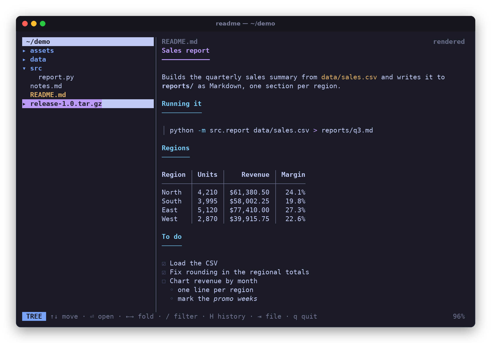

[](LICENSE)


```
cargo install --git https://github.com/bhoult/readme
readme ~/src/project
```

Or let your AI coding agent do it: point Claude Code, Codex or the like at
`https://github.com/bhoult/readme` and say "install this on my machine". readme was
designed to be [customized the same way](#make-it-yours). So far it has only been tested
on Linux.

## At a glance

- [**Tree**](#the-tree) of the folder, with folding, a name filter, and hidden and ignored files kept out of the way
- [**Markdown**](#markdown) rendered: headings, lists, task lists, tables, quotes, links, highlighted code
- [**Source code**](#source-code) highlighted for every language [bat](https://github.com/sharkdp/bat) knows, with search, word wrap and sideways scrolling
- [**Editing**](#editing) with selection, undo, the system clipboard, and each line's own line ending kept
- [**CSV and TSV**](#csv-and-tsv-tables) as aligned tables with the header kept on screen
- [**Images**](#images) at full resolution in terminals that can show them, with zoom, and colored half-blocks anywhere else
- [**Thumbnails**](#thumbnails) of a folder's images and videos, in a grid
- [**Videos**](#videos) play in the pane, with their sound, a volume control and a moving spectrum: MP4 and MOV with H.264, decoded in pure Rust
- [**Archives**](#archives): zip and tar files open like folders, nothing unpacked
- [**Git history**](#git-history) of any file or folder, as it was or as a diff, following renames
- [**Git branches**](#git-branches): whose each one is, when it last changed, and what it changed, file by file
- [**Find in files**](#find-in-files) across the whole tree, on every CPU core
- [**Managing files**](#managing-files): mark, drag to move, rename, send to the trash
- [**Live reload**](#live-reload) when another program changes the open file
- [**Web pages**](#web-pages) open in the browser, and other videos in the video player

## The tree

Directories come first and fold open as you click them. `..` at the top, or `Backspace`,
moves the tree up a folder, with the one you were in left open. Dotfiles and whatever
`.gitignore` leaves out (`target/`, `node_modules/`) stay hidden until you press `.`, and
the header says how many there are. A folder that a repository above it ignores as a
whole, such as one in a home folder kept in git with `*` in its `.gitignore`, still shows
what's in it. Git repositories show a ⎇. The tree reads the disk again every couple of
seconds, so new files appear on their own.

`s` sorts what's in each folder by name, biggest first, oldest first or newest first, with
folders always first; the header says how, when it isn't by name.

Press `/` and type to filter the whole tree by name. Every word has to match somewhere in
the path, so `src ar` finds `src/archive.rs` and `src/markdown.rs` but not
`docs/archive.png`.

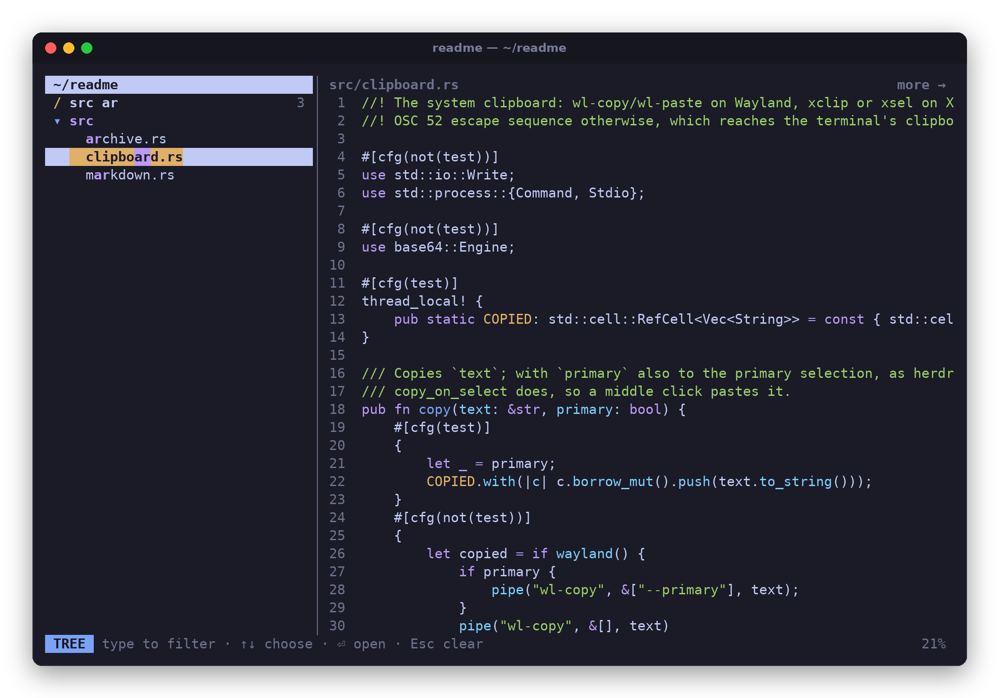

## Markdown

Markdown shows rendered: headings, lists, task lists, tables, block quotes, links with
their targets, and fenced code with syntax highlighting (the screenshot at the top). `m`
switches to the raw text and back, keeping your place, even inside a long paragraph or a
table. Wide tables and long code lines keep their shape and scroll sideways rather than
being squeezed.

## Source code

Highlighting covers every language bat knows, in the terminal's own colors, so it suits
light and dark themes alike. Line numbers, `/` search with `n` and `N`, and `w` for word
wrap. Without wrap, `←` and `→` scroll sideways, and the title says `more →` when a line
on screen runs past the edge. The header over a file gives its number of lines, its size
and when it last changed, on a band of color that sets it apart from the text: blue while
the file has the focus, gray otherwise.

Big files open straight away: colors are worked out a slice at a time, as far down as
you look.

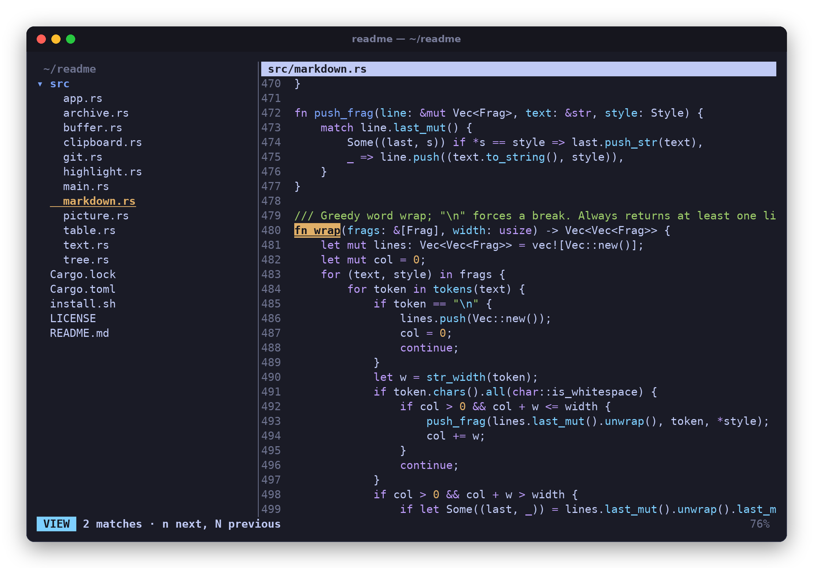

## Editing

Press `e` to edit and `Esc` to stop; `Ctrl+S` saves. Select with the mouse or
`Shift`+arrows, jump by words with `Ctrl`, undo and redo, and cut, copy and paste with
the system clipboard. New lines keep their indentation. Dragging across text copies it
straight away, the way terminals do. If you try to leave with unsaved changes, readme
asks first.

Files come back the way they went in: tabs stay tabs, a missing newline at the end stays
missing, and a file that mixes Windows and Unix line endings keeps each line's own.

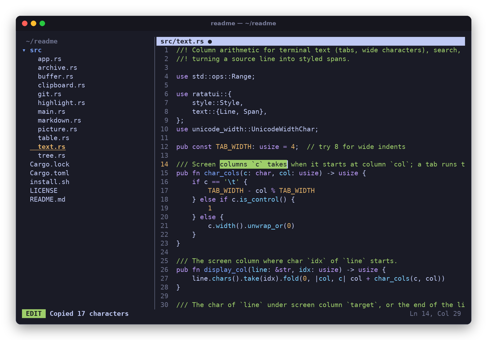

## CSV and TSV tables

CSV and TSV files show as tables: aligned columns, numbers lined up on the right, row
numbers down the side, and the header row kept on screen as you scroll. `m` shows the raw
text.

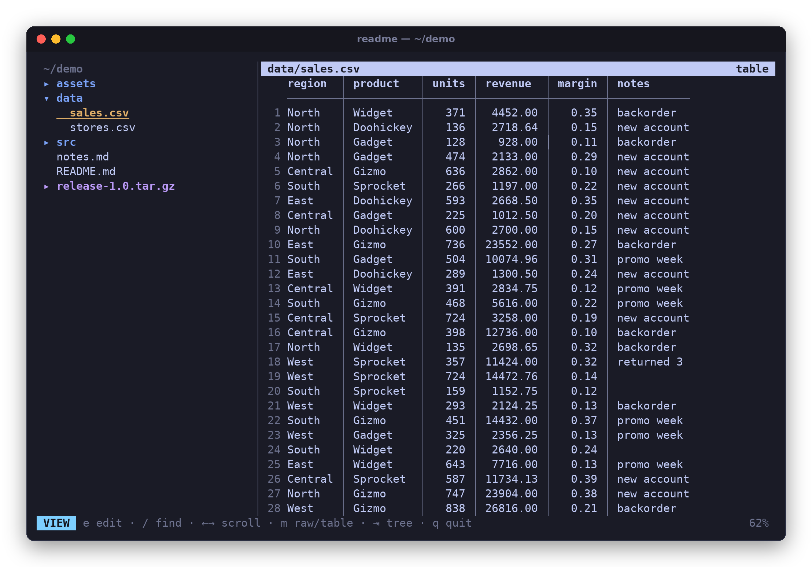

A table wider than the pane scrolls sideways with `←` and `→`, while the row numbers stay
put.

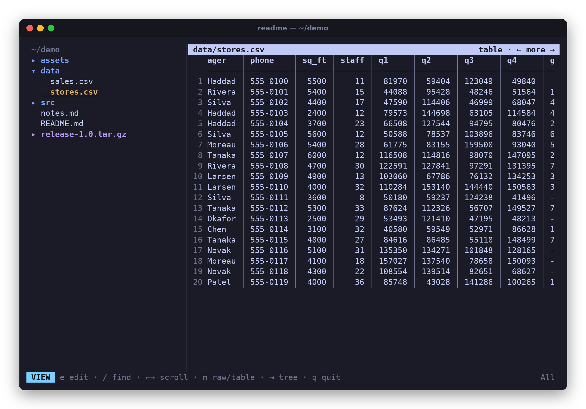

## Images

PNG, JPEG, GIF, WebP, BMP, TIFF, TGA, QOI, ICO, PNM and HDR images show at full
resolution in terminals with a graphics protocol: Kitty, Ghostty, WezTerm, Konsole,
iTerm2, and Sixel terminals. The header gives the image's size and format, and when it
last changed.

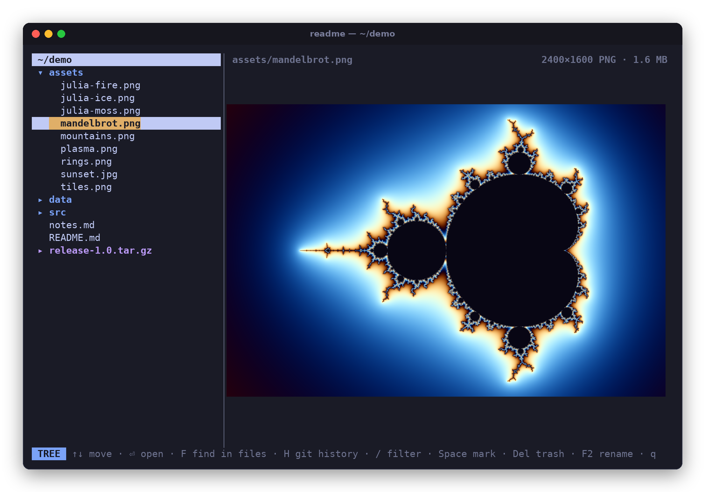

The wheel (or `+` and `-`) zooms toward the pointer, dragging or the arrow keys move
around, and `0` or a double-click fits the image again. Each view is scaled from the
full image, so zooming in shows the real detail rather than blown-up pixels.

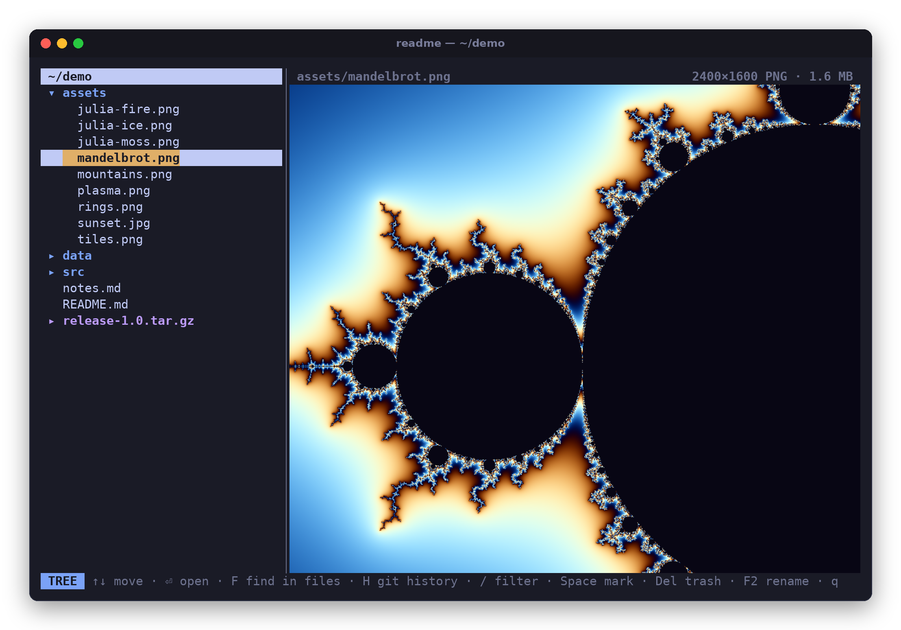

Anywhere else, images are drawn with colored half-blocks, two pixels to a character,
which works in any terminal with true color:

<p align="center">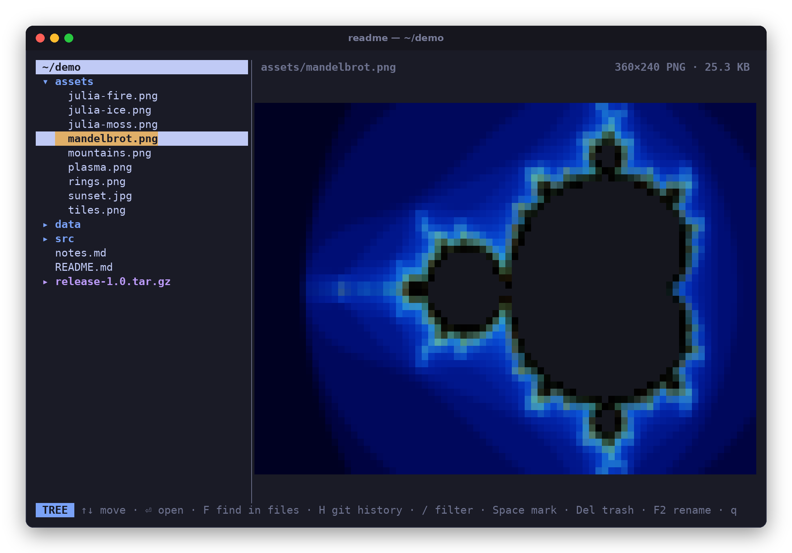</p>

## Thumbnails

Select a folder with images or videos in it and the right pane shows them as a grid. A
video shows as its picture a second in, with a play badge in the corner. They load in
the background, on up to six cores, as they come into view. They start 100 pixels wide;
`+` and `-` (or `Ctrl`+wheel) change their size, and a click or `Enter` opens one, and
plays a video. `Esc` goes back to the grid.

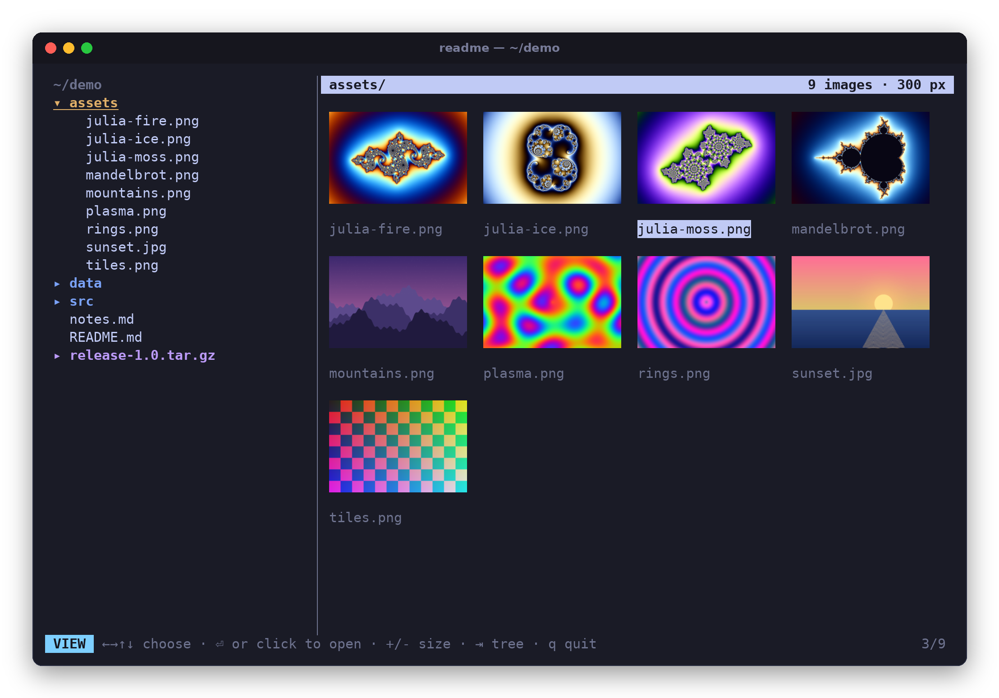

## Videos

MP4 and MOV videos with H.264 pictures play in the right pane: most screen recordings,
videos made with ffmpeg, and older phones' videos. Select one and it plays; `Space`
pauses and plays it, in the tree as well as in the pane, and so does a click on the
picture. `Enter` opens it in your video player instead, pausing it here. Videos start
with their sound off; `m` turns it on, from the tree too, and it stays on for the videos
after, until it's turned off or readme quits. Under the picture is the time, a bar to
click to go anywhere in it, and the volume: click `muted` to turn the sound on, click a
step to set it, or turn the wheel. The volume stays as you set it for the next video.
Under the bar, the sound's spectrum moves as it plays, sound on or off: a bar for each
band of pitches, the low ones on the left, leaping up as loud as they are and falling
back.

| Keys | |
|---|---|
| `Space` | play or pause, in the tree too |
| `←` `→` | 5 seconds back or on |
| `↑` `↓` | a minute on or back |
| `Home` | back to the start |
| `m` | sound on or off, in the tree too (it starts off) |
| `+` `-` | louder or quieter, a tenth at a time |
| `Enter` `o` | open it in your video player, pausing it here |
| `Esc` | back to the tree, still playing |

Pictures are drawn in real pixels where images are, and in half-blocks anywhere else.
A terminal that reads pictures from files, as Ghostty and herdr do, gets each one at
full size in a temporary file that it deletes once read. Elsewhere they go as text, so
readme sends them only as big as the terminal (and herdr or tmux) takes as fast as they
come, starting from about a quarter of a megapixel, and the terminal scales them up to
fill the pane.

Sound plays through ALSA, which every Linux desktop has, PipeWire and PulseAudio
included; readme loads it when a video first plays, so it needs nothing to build, and
without it videos play silently. AAC sound plays, in mono or stereo. The pictures keep
time with it.

Nothing else is needed: the decoder is [rust_h264](https://github.com/roticv/rust_h264),
in pure Rust, with fixes to it made for readme
([vendor/rust_h264](vendor/rust_h264/PATCHES.md)), and AAC is
[Symphonia](https://github.com/pdeljanov/Symphonia)'s. Videos readme can't play, such as
HEVC, VP9 or AV1 ones, or Matroska and WebM files, say so and open in your video player.

## Archives

Zip files (and `.jar`, `.whl`, `.epub`) and tar files, plain or compressed with gzip,
bzip2, xz or zstd, open in the tree like folders. The files inside open like any other,
highlighted or rendered, without anything being unpacked to disk. A tar file has no
index, so a very big compressed one is listed as far as readme gets through it in a few
seconds.

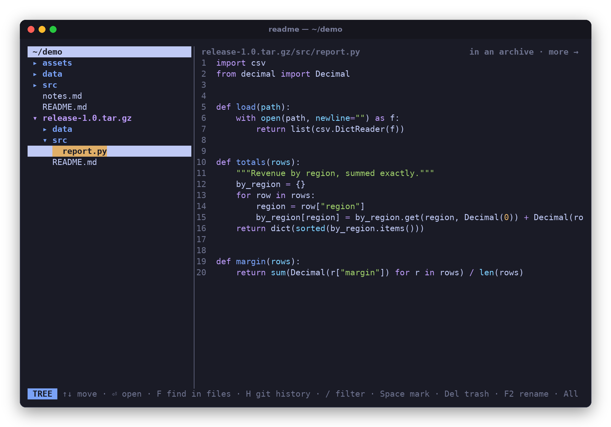

## Git history

Press `H` on any file or folder in a git repository. For a file, you get the commits that
touched it, following it back through renames. Each one shows the file as it was then,
or with `d`, what that commit changed. `Enter` opens a commit to go through every file it
changed, `a` lists all the files as of that commit, and `←` widens a file's history to its
folder and on up to the whole repository.

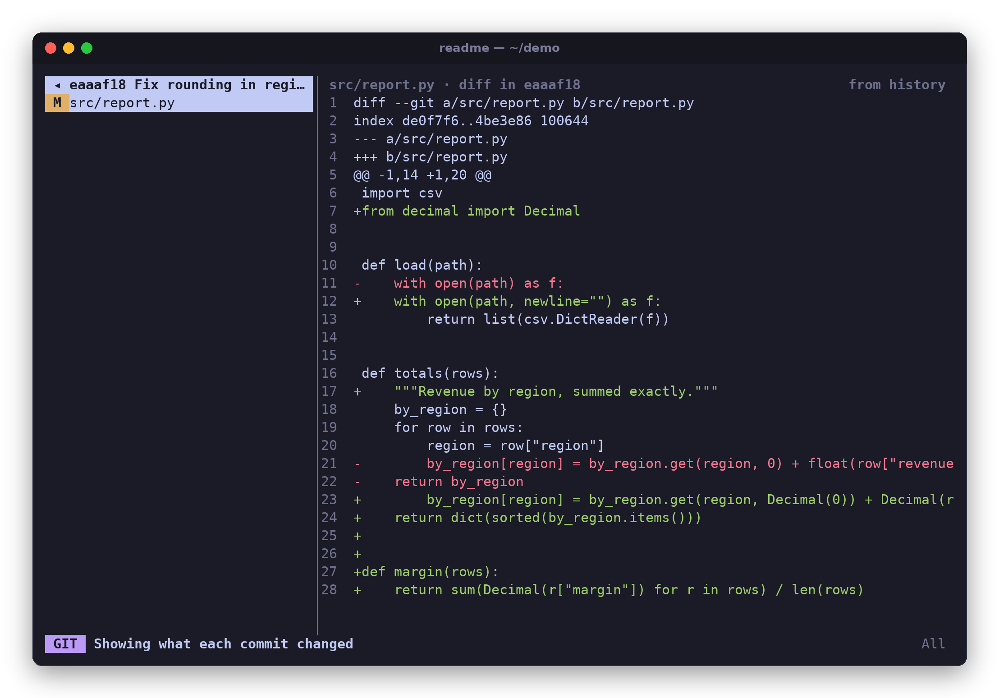

## Git branches

Press `B` on any file or folder in a git repository to see all the repository's
branches, with whose each one is and when it was last updated. The branches that changed
what you pressed it on come first, and the rest are dimmed. Each branch is compared with
the repository's main branch (the one `origin/HEAD` names, or else `main` or `master`)
from where it split off, so you see only what that branch did. Its owner is whoever made
most of those commits. A remote's branches are included too, as of your last `git fetch`;
one at the same commit as the local branch of the same name is listed once, as the local
one.

`s` sorts the branches newest first, by name or by owner, and `f` switches between all
of them, just the local ones and just the remote's. Either way, the ones that changed
what you pressed `B` on stay at the top.

Showing just the remote's fetches them, in the background: they're listed as of your
last fetch, then again once it's done, with the same branch selected. It's done at most
once a minute per repository. Nothing in it can ask for a password or passphrase, so a
remote that needs one you haven't given an ssh agent or credential helper says it can't
be fetched, as does one that hasn't answered within a minute.

Moving through the list shows each branch's page: its owner, when it changed, its
commits, and the diff. `Enter` opens a branch to go through the files it changed, each as
a diff, or with `d` as the branch has it. `a` lists every file it changed, not just the
ones under the file or folder, `←` widens to the folder around and on up to the whole
repository, and `H` switches to the history.

## Find in files

`F` searches the text of every file under the tree's folder, on all the CPU cores.
Matches fill the left pane as they're found, grouped by file. Moving through them shows
each file at its line with the match marked, and `n` and `N` step through the rest of
that file. Binary files are skipped, as is whatever the tree hides (press `.` first to
include it). Text files over 10 MB are skipped too, and the list ends by saying how many.
Case doesn't matter unless the search has a capital letter in it.

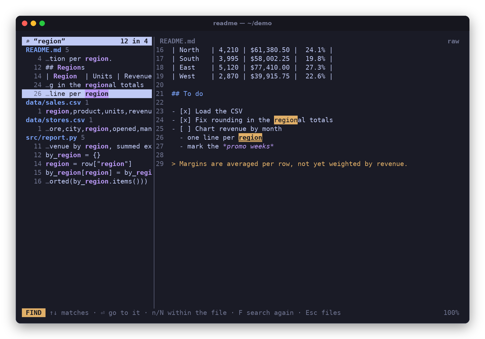

## Managing files

Mark files with `x` or `Ctrl`+click (`Shift`+`↑`/`↓` or `Shift`+click for a range).
Then drag them onto a folder to move them there, or press `Delete` to send them to the
trash. `F2` renames. Each of these asks before it does anything, nothing gets
overwritten, and an open file follows its new name.

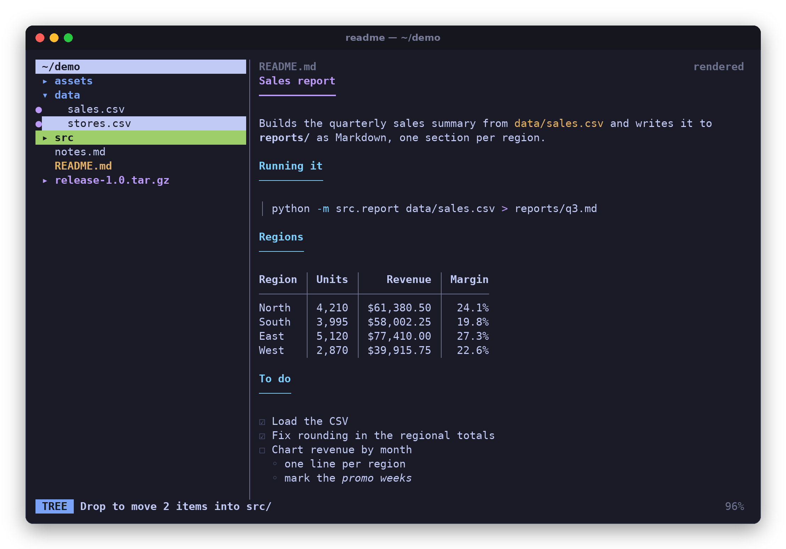

## Live reload

When something else changes the open file, readme reloads it and keeps your place, so
you can watch a log grow or an agent write. An image redrawn on disk (a plot, a
screenshot) shows the new one at the same zoom. If you have unsaved changes of your own,
readme keeps them and marks the file as changed on disk instead; undo them and the new
contents come in, or save, and it asks before writing over the other changes.

## Web pages

Pressing `Enter` on an HTML file opens it in your browser, and on a video, in your video
player. Only `Enter` opens other programs: clicking a file shows it here.

## Make it yours

readme was designed to be customized by your favorite LLM. Want different keys, other
colors, a file type it doesn't show yet, or a feature only you need? Open the project in
Claude Code, Codex or whatever agent you use and ask for it.

It's built to make that easy. It's plain Rust in a handful of files, one job each (listed
under [Building](#building)), with comments that say why things are the way they are. The
tests drive the whole app, keys, mouse and all, so an agent can check that its change
didn't break anything else.

## Install

So far readme has only been tested on Linux. Other systems may need changes, which is a
good first job for your LLM.

The easy way: point Claude Code, Codex or another coding agent at
`https://github.com/bhoult/readme` and say "install this on my machine". It will sort
out what's needed.

By hand, you need Rust 1.90 or newer and a C compiler (for the xz and zstd decoders),
plus `git` for the history and branches. herdr isn't needed; any terminal will do, and one with
Kitty graphics or Sixel support shows images at full resolution.

```
cargo install --git https://github.com/bhoult/readme
```

Or clone it and run `./install.sh`, which builds a release binary and puts it in
`~/.local/bin/readme`.

## Use

```
readme              # browse the current directory (opens its README if it has one)
readme ~/src/project
readme src/main.rs  # open a file, with its directory in the tree
```

`?` (or `F1`) shows the help: the version and when it was built, a link to this
repository, the features, and the keys. `readme --version` gives the version and build
date too.

### Keys

| Where | Keys |
|---|---|
| Anywhere | `?` help (`F1` while typing) · `Tab` switch panes · `Ctrl+S` save · `Ctrl+Q` or `Ctrl+C` quit |
| Tree | `↑↓` `j` `k` move · `Enter` open · `←→` `h` `l` fold · `s` sort · `/` filter · `.` hidden files · `r` refresh · `H` git history · `B` branches · `F` find in files · `q` quit |
| Files | `x` mark · `Shift`+`↑↓` mark a range · `Delete` to the trash · `F2` rename · `Esc` unmark |
| Filter | type to filter · `↑↓` choose · `Enter` open · `Esc` clear |
| Find in files | `↑↓` matches · `Enter` go to it · `n` `N` within the file · `F` search again · `Esc` back to the tree |
| File | `↑↓` `PgUp` `PgDn` `Home` `End` scroll · `←` back to the tree (when not scrolled sideways) · `→` sideways · `/` search, `n` `N` next/previous · `w` word wrap · `e` edit · `m` raw/formatted · `y` copy selection · `q` quit |
| Editing | `Esc` stop · `Ctrl+Z` `Ctrl+Y` undo/redo · `Ctrl+C` `Ctrl+X` `Ctrl+V` copy/cut/paste · `Ctrl+A` select all · `Ctrl+F` search · `Alt+Z` word wrap · `Shift`+arrows select · `Ctrl`+arrows by word |
| Images | wheel or `+` `-` zoom · `0` fit · `←→↑↓` or drag to move around |
| Thumbnails | `←→↑↓` choose · `Enter` open · `+` `-` size · `Esc` (in an image or a video) back to the thumbnails |
| Videos | `Space` play/pause and `m` sound, in the tree too · `Enter` the video player · `←→` 5 s · `↑↓` 1 min · `Home` start · `+` `-` volume · `Esc` back to the tree |
| History | `↑↓` commits · `Enter` a commit's files · `d` diff or file · `a` all files at that commit · `←` back, or wider · `B` branches · `Esc` leave |
| Branches | `↑↓` branches · `Enter` a branch's files · `d` diff or file · `a` all the files it changed · `s` newest first, by name or by owner · `f` all, local or remote branches (fetching the remote's) · `←` back, or wider · `H` history · `Esc` leave |

`Tab` always switches panes, even while editing, so there is no key that inserts a tab
character. `Enter` keeps the line's indentation. With word wrap on, the arrow keys move
by screen row. `Ctrl+C` copies while you're editing with text selected; anywhere else it
quits, asking first if there are unsaved changes.

### Mouse

- Click a directory or an archive to fold or unfold it; click a file to open it (a video
  plays); double-click a file to move into it. Clicks never open other programs: `Enter`
  does that.
- The wheel scrolls whichever pane it's over; `Shift`+wheel scrolls sideways.
- Drag across text to select and copy it. While editing, a click moves the cursor and a
  double-click selects a word; while viewing, a double-click starts editing there.
  Middle-click pastes the primary selection while editing.
- In the history and the branches, click a commit, branch or file to show it,
  double-click to open it, and click the title to go back.
- `Ctrl`+click marks files in the tree; drag a file, or marked files, onto a folder to
  move them there.
- On an image, the wheel zooms toward the pointer, dragging moves it, and a double-click
  fits it again. Over thumbnails, `Ctrl`+wheel resizes them.
- On a video, a click plays or pauses it, and a click on the bar under it goes there. A click on the volume control turns the sound on or off, or sets the
  volume, and the wheel turns it up or down.
- Drag the divider between the panes to resize the tree.

### Clipboard

Selecting text with the mouse copies it, to the clipboard and to the primary selection.
readme uses `wl-copy` and `wl-paste` on Wayland, `xclip` or `xsel` on X11, and the OSC 52
escape sequence otherwise, which also reaches your own clipboard over ssh.

### Images and terminal multiplexers

Outside a multiplexer, readme asks the terminal what it can draw and uses real graphics
if it can. Inside tmux, zellij or screen it draws half-blocks, because those answer the
question themselves even when the terminal around them can't show the result.

Inside [herdr](https://herdr.dev), which passes Kitty graphics on only to Ghostty,
WezTerm and kitty, readme looks at the terminal each herdr window runs in, the way herdr
does. When every window attached to the session is in one of those, images use real
pixels; otherwise half-blocks (Linux only). So run herdr in Ghostty, say, rather than
GNOME Terminal, and keep any other windows on that session in such a terminal too.

`README_IMAGES` overrides the choice: `kitty`, `sixel`, `iterm2`, `halfblocks`, or `auto`
to ask the terminal.

### Colors

Highlighting uses bat's `ansi` theme by default, which draws with the terminal's own
palette. Set `README_THEME` to use another of bat's themes, for example `Nord`,
`Monokai Extended` or `GitHub`.

## Built to stay quick

- Searching and filtering use every CPU core, and thumbnails up to six.
- Videos decode on a thread of their own, a few pictures ahead, each made at the size
  it's shown. Pictures nothing else needs are skipped when seeking or running late.
- Syntax colors are worked out only as far as you've looked, a slice per frame, and kept
  across reloads down to the first line that changed.
- Memory stays bounded: files over 50 MB aren't opened, Markdown over 5 MB shows as text,
  thumbnails decode within a shared 256 MB budget, and git output is capped.
- Nothing waits forever: a stuck clipboard program, a terminal that never answers, and a
  huge archive each get a time limit.

## Building

```
cargo build --release
cargo test
```

The tests include the whole app driven through ratatui's test backend, mouse clicks and
drags included.

| File | |
|---|---|
| `src/main.rs` | terminal setup and the event loop |
| `src/app.rs` | state, keys, mouse, drawing |
| `src/tree.rs` | the directory tree and its filter |
| `src/buffer.rs` | the text being edited: cursor, selection, undo, line endings |
| `src/highlight.rs` | syntect highlighting, cached and computed only as far as shown |
| `src/markdown.rs` | the Markdown renderer |
| `src/table.rs` | CSV and TSV as tables |
| `src/picture.rs` | images, and asking the terminal how to draw them |
| `src/gallery.rs` | the thumbnail grid |
| `src/archive.rs` | reading zip and tar archives |
| `src/git.rs` | history and branches, through the `git` command |
| `src/grep.rs` | find in files |
| `src/fileops.rs` | trash, rename and move |
| `src/video/` | videos: the MP4 reader, decoding, sound, and Kitty pictures |
| `src/external.rs` | opening web pages, and videos readme can't play, in other programs |
| `src/text.rs` | column math, wrapping, search, styled line slices |
| `src/clipboard.rs` | copy and paste |

Built with [ratatui](https://ratatui.rs) and
[ratatui-image](https://github.com/ratatui/ratatui-image),
[syntect](https://github.com/trishume/syntect) with
[two-face](https://github.com/CosmicHorrorDev/two-face) for bat's syntaxes,
[pulldown-cmark](https://github.com/pulldown-cmark/pulldown-cmark),
[ignore](https://github.com/BurntSushi/ripgrep/tree/master/crates/ignore),
[csv](https://github.com/BurntSushi/rust-csv), [image](https://github.com/image-rs/image),
[zip](https://github.com/zip-rs/zip2), [tar](https://github.com/alexcrichton/tar-rs),
[rust_h264](https://github.com/roticv/rust_h264) and
[Symphonia](https://github.com/pdeljanov/Symphonia).

## License

[MIT](LICENSE). The H.264 decoder in [vendor/rust_h264](vendor/rust_h264) is
rust_h264's own, under MIT or Apache-2.0.
